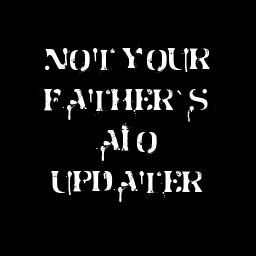

<H1 align="center"> UNDER CONSTRUCTION </H1>  
<H2 align="center"> Being updated for Atmosphere 1.12.1 and HOS 23.0.1 </H2>  

# NYF-AIO-Switch-Updater

<p align="center">
<br>
</p>

## Not Your Father's AIO-Switch-Updater  
A Nintendo Switch homebrew app to update your CFW and cheat codes, download firmwares and more directly from your Nintendo Switch! Supports Atmosphère =<1.12.1

Supports all "Switch" models (V1 un-patched, V1 patched, V2, Lite, OLED).

## How to install
Copy the `nyf-aio-switch-updater/` directory to `/switch/` on your sdcard.

## Features
### ⬦ Update CFW
- Update the Atmosphère Switch Custom Firmware. NYF-AIO-Switch-Updater uses a custom RCM payload to finalise the install as it can't be performed while HOS is running.
  - If you would like to preserve additional files or directories, write their path (one line each) in `/config/nyf-aio-switch-updater/preserve.txt` and they won't be overwritten when updating.
  - Place [this file](https://github.com/robzilla10001/nyf-aio-switch-updater/blob/master/copy_files.txt) in `/config/nyf-aio-switch-updater/copy_files.txt` in order to have specific copy operations performed after each download. This is mainly meant for users with trinkets who want payloads automatically copied to a directory.

### ⬦ Update Hekate/Payload
- Download and update Hekate, as well as a selection of RCM payloads

### ⬦ Custom Downloads
- A custom Atmosphère url can be entered in [this file](https://github.com/robzilla10001/nyf-aio-switch-updater/blob/master/custom_packs.json). Once moved to `/config/nyf-aio-switch-updater/custom_packs.json`, it will show on the `Custom Download` menu. This can be used to support third-party packs through NYF-AIO-Switch-Updater. Packs whose name starts by `[PACK]` won't prompt for a Hekate download.
- Non-Atmosphère downloads can also be added in the `misc` category.

### ⬦ Download firmwares
- Download firmware files to `/firmware` that can then be installed using DayBreak.

### ⬦ Download cheats
- Download and extract daily-updated cheat code. The program will only extract cheat codes for the games you own. By default, this homebrew will overwrite the existing cheats. If you have your own cheat files that you'd like to keep as is, you can turn off cheat updates for specific titles in `Tools→Cheat Menu`.
- Download cheat sheets from [Cheat Slips](https://www.cheatslips.com/). 
- Download individual cheat codes from the `GBAtemp.net` database.

## Extras (in the `Tools` tab)
- Reboot to specific payload.
- Consult games with missing updates.
- Change software color scheme of Joy-Cons. Additional color profiles can be found in the releases and should be copied to `config/nyf-aio-switch-updater/jc_profiles.json`. Use [this webpage](https://hamletdufromage.github.io/JC-color-picker/JCpicker.html) to generate your own profiles.
- Change software color scheme of Pro Controllers (has to be paired as Player 1). Additional color profiles can be found in the releases and should be copied to `config/nyf-aio-switch-updater/pc_profiles.json`.
- Consult installed cheat codes.
- Launch the Switch's web browser.
- Edit internet settings (DNS, IP address, MTU, etc). Add you own configs to `config/nyf-aio-switch-updater/internet.json`. You can find a template in the root of the repo.
- Tabs can be hidden through the `Hide tabs` menu, and more entries can be hidden by manually editing [`config/nyf-aio-switch-updater/hide_tabs.json`](https://github.com/robzilla10001/nyf-aio-switch-updater/blob/master/hide_tabs.json).

## Screenshots
<details><summary>Expand to view the screenshots</summary>


</details>

## Build

<details><summary>Expand to view the build instructions</summary>

You need to have installed devkitPro and devkitARM in order to compile this project.

Install the required dependencies:
```bash
$ sudo (dkp-)pacman -Sy
```
```bash
$ sudo (dkp-)pacman -S  switch-glfw \
                        switch-curl \
                        switch-glad \
                        switch-glm \
                        switch-mbedtls \
                        switch-zlib \
                        devkitarm-rules
```
Use [`switch-ex-curl`](https://github.com/eXhumer/switch-ex-curl) instead of `switch-curl` to use this app with an invalid SSL certificate.

Clone the repository
```bash
$ git clone https://github.com/robzilla10001/nyf-aio-switch-updater
$ cd nyf-aio-switch-updater
```

Compile (Borealis and TegraExplorer are included in the repository, and the forwarder is built automatically)
```bash
$ make
```
The build products are placed in `output/`. `./pack_release.sh` zips them up as `output/nyf-aio-switch-updater.zip`.

</details>

## Contribute

PRs and suggestions are encouraged! ~~If you wish to help with the localization of the app, you can translate the files in `resources/i18n/`. To easily find the non-translated strings and translate them, you may use `localizer.py` (e.g. `python localizer.py -r resources//i18n//en-US//menus.json -w resources//i18n//fr//menus.json`).~~ Language files are going to be exported to make translation a breeze, stay tuned!

## Disclaimer
I do not own, host nor distribute any of the files that can be downloaded with this homebrew tool. At the owner's request, I will immediately remove the ability to download any problematic file.

## Why the name change?  
To distinguish this project from the parent project, in case the [original author](https://github.com/HamletDuFromage) returns to the project and decides to pick up where he left off. Just figured while he was away, I'd make some updates/upgrades. If you like them, great! If not, sincerest apologies.

## Special thanks
- [HamletDuFromage](https://github.com/HamletDuFromage) for the original AIO Updater. I hope you're not offended by my changes.
- [natinusala](https://github.com/natinusala) for the Borealis library.
- [tiansongyu](https://github.com/tiansongyu) for bringing support for multi-language and for his Chinese translation.
- [yyoossk](https://github.com/yyoossk) for the Japanese locale.
- [sergiou87](https://github.com/sergiou87) for the Spanish locale.
- [pedruhb](https://github.com/pedruhb) for the Brazilian locale.
- [AD2076](https://github.com/AD2076) for the Italian locale.
- [qazrfv1234](https://github.com/qazrfv1234) for the Traditional Chinese locale.
- [Nota Inutilis](https://github.com/NotaInutilis/) for the French locale.
- [Team Neptune](https://github.com/Team-Neptune) whose rcm code HamletDuFromage used (and I then appropriated).
- [fennectech](https://github.com/fennectech) for helping test the original app and providing suggestions.
- [GBATemp members](https://gbatemp.net/forums/nintendo-switch.283/) for testing, un-constructive criticism, and helping me to find the strength to question every choice I've ever made in life.
- [Switch Port Zone Discord](https://discord.gg/aCaza7xDZH) for legit support, more testing, feature suggestions, etc. Fantastic community.
- Iliak for [Cheat Slips](https://www.cheatslips.com/).

### Like the app?  

Please consider supporting my work. Links on the right side (on desktop). This is the only time I'll ask, the app is free from nags or begging.
